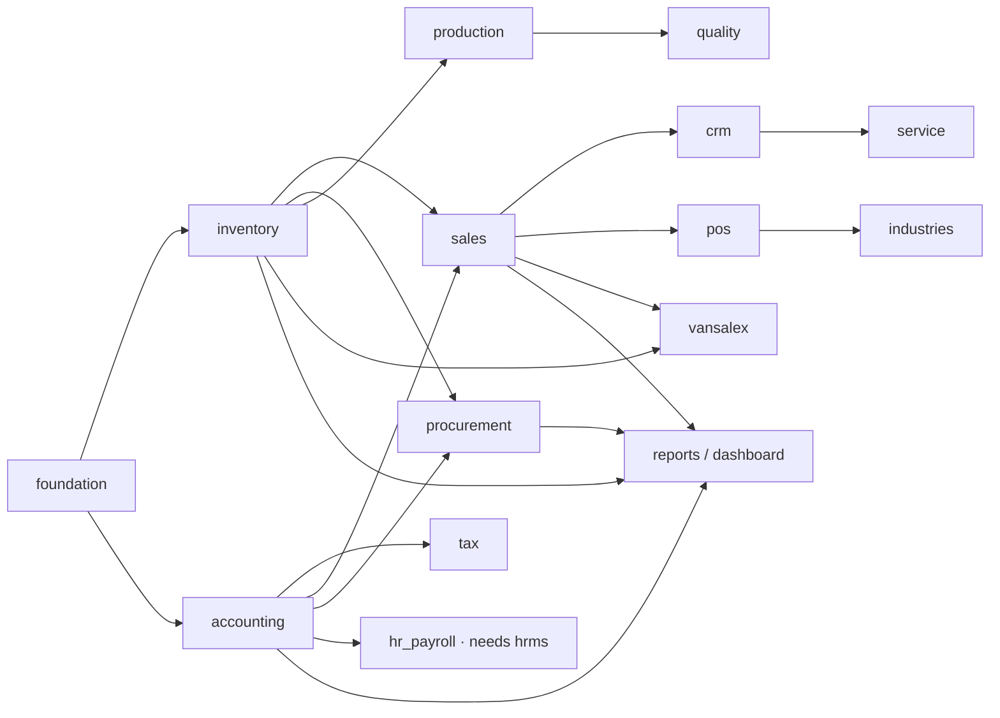

# Module dependencies (proposal)

*Phase 2, 2026-11-28. Maps your target modules to ERPNext, existing ZatGo code and the licensing registry. Module ids are the registry's (`licensing/catalog/`, stable forever).*

## Target modules
| Your module | Registry id | Standard ERPNext | ZatGo today | Optional? | Depends on |
|---|---|---|---|---|---|
| CRM | `crm` | Lead, Opportunity, Customer | `api/v1/crm/` (thin) | optional | Sales |
| Sales | `sales` | Quotation, Sales Order, Delivery Note, Sales Invoice, returns | accounting API, naming, print, ZATCA QR, Duplicate Prevention | core | Foundation, Accounting (to post), Inventory (stock items) |
| Procurement | `procurement` | Material Request, Purchase Order, Purchase Receipt, Purchase Invoice | accounting API, VanSaleX purchases | optional | Foundation, Accounting, Inventory |
| Inventory | `inventory` | Item, Warehouse, Stock Entry, Stock Reconciliation, Stock Ledger | source-warehouse fill, VanSaleX stock rules, transfer point | core for trading | Foundation |
| Production | `production` | BOM, Work Order, Job Card | none | optional | Inventory |
| Quality | `quality` | Quality Inspection, Goals, Procedures | none | optional | Production or Procurement (inspections) |
| Finance | `accounting` (+ `tax`) | GL, Payment Entry, Journal Entry, AR/AP, Tax Templates | multi-payment, cash auto-payment, narration, PE account fill, ZatGo ERP workspace | core | Foundation |
| Service | `service` | Issue, Warranty Claim, Maintenance Visit | ZG Service Ticket, `api/v1/service/` | optional | CRM or Sales |
| HR | `hr_payroll` | needs the **hrms** app | Tracker uses Employee | optional, only where `hrms` is installed | Accounting |
| Gate Management | — (not registered, D7) | none | none | would be new ZatGo functionality | Inventory, Procurement |
| Reports | `reports` + `dashboard` | Script/Query Reports, Dashboards | Business Summary, Payment Method Summary, MyBis, Number Cards | core | the modules it reports on |
| POS | `pos` | POS Profile, POS Invoice, Opening/Closing | ZatGo POS (retail, restaurant) | optional | Sales, Accounting |
| Van sales | `vansalex` | (uses Sales/Stock/Accounts) | VanSaleX | optional | Sales, Inventory, Accounting |
| Industries | `industries` | — | Gym, Jewellery, Restaurant, Textile, Supermarket | optional per vertical | Sales, POS (restaurant/supermarket) |
| Foundation | `foundation` | Company, users, masters read, print, backups | settings, roles, Desk | always on | — |

## Graph

## Lifecycle rules (Phase 5, proposed)
| Action | Effect | Never |
|---|---|---|
| Enable | dependencies checked; workspaces and sidebars appear for authorized roles; APIs answer | auto-enable a paid dependency (registry rule: dependencies are reported, not added) |
| Disable | refused if an enabled module depends on it; navigation hides; ZatGo APIs answer 404; ZatGo DocType writes refused; ERPNext core screens stay as ERPNext permissions allow | delete data, DocTypes or fields |
| Not installed (`hrms`, a vertical app) | module shown as unavailable | pretend it can be enabled |
| Not licensed (when enforcement is on) | read-only per D6 | disable existing users |

**Installed** (Frappe app), **enabled** (ZG Module Settings), **licensed** (signed licence), **authorized** (roles and User Permissions) and **visible** (workspace) are five separate states. `core.availability.explain()` reports each one.
