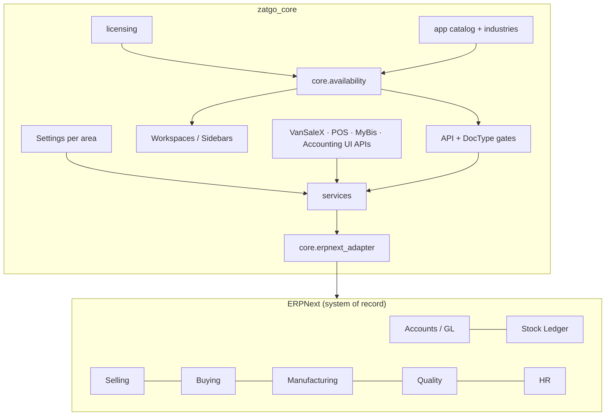
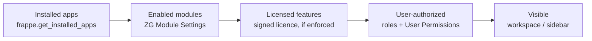
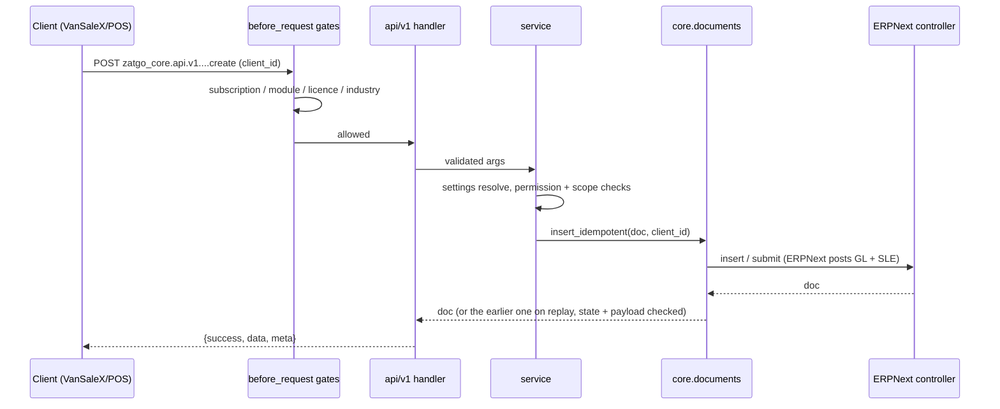
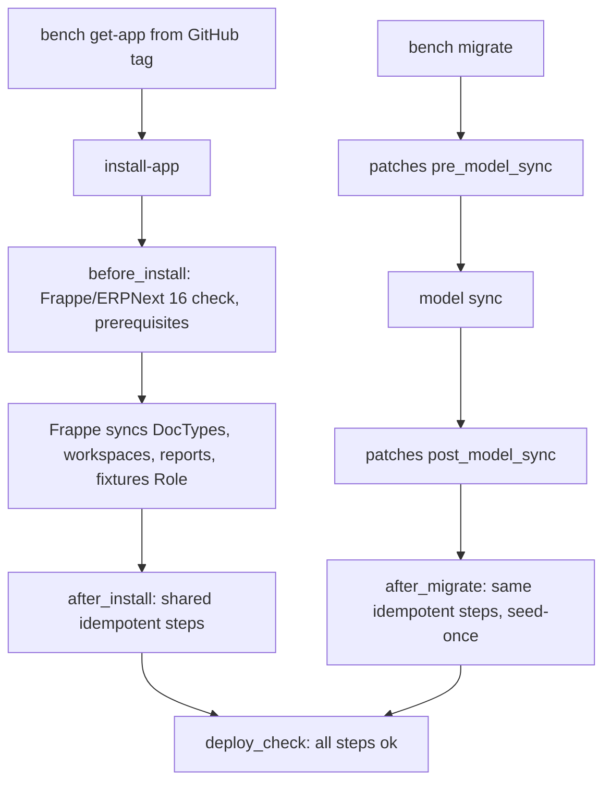
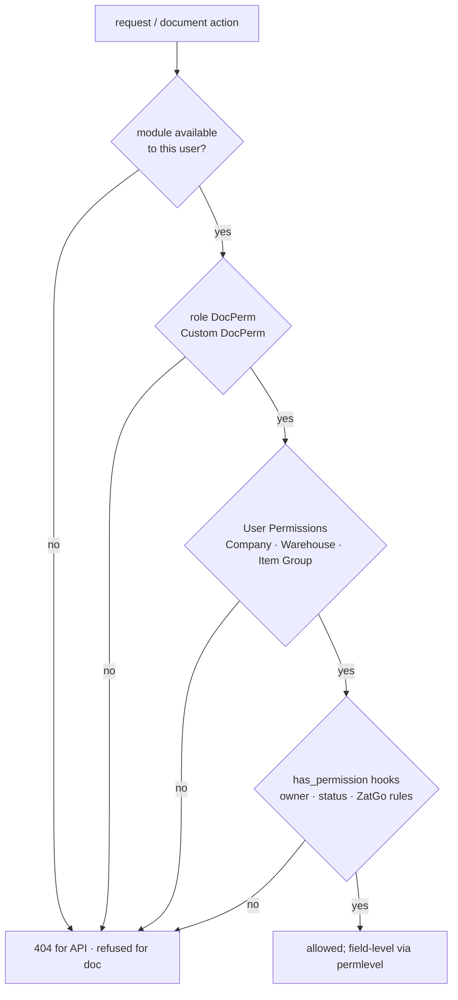
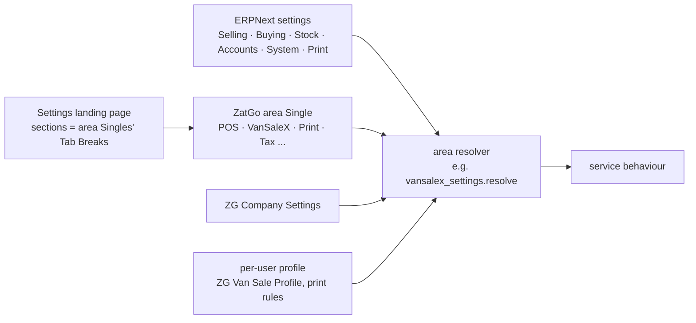

# Target architecture (proposal, for validation)

*Phase 2, 2026-11-28. A proposal, not implemented. It evolves the existing app; nothing is rebuilt. Decisions and alternatives are in `ARCHITECTURE_DECISIONS.md`, modules in `MODULE_DEPENDENCIES.md`.*

## 1. Principles
1. **ERPNext is the system of record** for accounting, stock, sales, purchasing, HR and manufacturing. ZatGo adds configuration, navigation, client APIs, vertical features and guardrails. It never adds a second ledger or a parallel document flow.
2. **Native Frappe first**: Workspace, Workspace Sidebar, Role, DocPerm, User Permission, `permission_query_conditions`, `has_permission`, Single DocTypes, Script Reports, Number Cards and Dashboard Charts, patches.
3. **Evolve in place.** Keep the existing folders and whitelisted method paths (clients call them by path). Move code only to remove proven duplication, and register old paths in `compat_methods`.
4. **Visibility is not security.** Navigation is computed from availability and roles. Every read and write is decided again on the server.
5. **One source of truth per concern**: one availability resolver, one settings reader per area, one registry per kind.

## 2. Structure (adapted from the brief to this app)
The brief's `modules/sales/…` tree is **not** adopted. In Frappe, a "module" is a folder with `doctype/`, `workspace/` and `report/`, listed in `modules.txt`. Splitting the 61 ZatGo Core DocTypes into new Frappe modules would change every DocType's `module` and needs a migration for no runtime gain. Instead:

```
zatgo_core/
  hooks.py, modules.txt, patches.txt        unchanged roles
  api/v1/<domain>/        thin whitelisted handlers (paths stable)
  services/               business logic, one file or package per domain
    core/                 NEW: shared foundation (Phase 3)
      availability.py       installed app → enabled module → licensed → user-authorized → visible
      erpnext_adapter.py    every call into ERPNext internals (C-02)
      documents.py          idempotent create/submit/cancel (wraps idempotency.py, submit_or_rollback)
      audit.py              ZG Audit Log writer
      errors.py             typed errors → one API error shape (api/response.py)
    duplicate/, mybis/, vansalex_*.py, *pos*.py, ...   (existing; split large files when touched)
  permissions/            hooks: owner, company, module; row_scope helpers
  licensing/              commercial layer (unchanged; already modular)
  industries/             verticals (unchanged pattern)
  setup/                  idempotent install/migrate steps (seed-once markers everywhere)
  zatgo_core/             the Frappe module "ZatGo Core": doctype/, workspace/, report/, page/, number_card/
  chat_ai/, tracker/, zatgo_space/   bundled Frappe modules (unchanged pattern)
  public/{js,css,images}/, templates/, translations/, patches/, tests/{unit,integration,permissions,api}/
```

## 3. Module relationships


## 4. Availability (one resolver, four layers)

- `core.availability.is_available(feature_or_module, user=None)` and `.explain(...)` are the only entry points. The app gate, DocType gate, sidebar builder, boot payload and client capability contract (`licensing.capabilities`) all call them.
- Existing readers (`app_state`, `industries.gate`, `licensing.entitlement`) become its layers rather than being removed.

## 5. Data flow (a sale from a client)


## 6. Installation and upgrade flow

Each step is idempotent and reports failure. Customer-editable records (print formats, perms, workspaces a customer changed) are **seeded once**. Uninstall keeps data and lists what remains.

## 7. Permission flow

SQL that cannot use `get_list` goes through `permissions/row_scope`. Reports and exports reuse the same checks (`query_report` override), and background jobs run as the user who queued them or as a documented system context.

## 8. Settings flow

Order: ERPNext default, then ZatGo area setting, then company, then user. Settings change behaviour going forward and never rewrite existing documents.

## 9. Multi-site
- One codebase, configured per site through settings, module enablement and licence.
- Nothing site-specific lives in the generic app: customer print formats move to an optional pack or site records (C-09).
- `site_config` keeps what site admins must not change.
- CI installs on a clean site and upgrades from each production commit (Phase 13/14).
